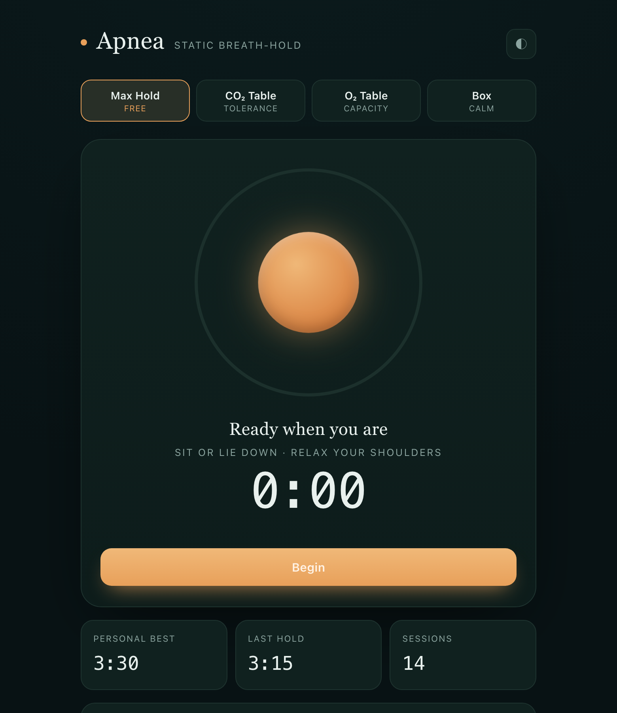

# Apnea — Breath-Hold Trainer

A calm, single-file web app for **dry static apnea** (breath-hold) training. Guided
breathe-ups, a max-hold timer, and the classic CO₂ / O₂ tolerance tables — with a
breathing orb that paces you so you can train with your eyes half-closed.

No build step, no dependencies, no server. Open `index.html` and go.

**Live:** https://ian-flores.github.io/apnea-trainer/



> ⚠️ **Dry static only.** Everything here is for breath-holds on land, sitting or
> lying down. **Never** hold your breath in or near water without a trained buddy
> watching — shallow-water blackout gives no warning and is fatal alone. See
> [Safety](#safety) below.

## Features

- **Max Hold** — a guided 40 s breathe-up, a final-breath cue, then an open-ended
  count-up hold. Tap **Stop hold** to bank the time (holds under 10 s are treated as an
  accidental tap and not logged). Tracks your personal best.
- **CO₂ Table** — 8 rounds, fixed hold with shrinking recovery periods. Builds
  tolerance to the urge to breathe.
- **O₂ Table** — 8 rounds, fixed 2:00 recovery with lengthening holds. Builds
  breath-hold capacity.
- **Box Breathing** — 4-4-4-4 to calm the nervous system before a session.
- **Breathing orb + progress ring** — expands on the inhale, holds full during a
  hold, turns seafoam and shrinks during recovery. Soft tones mark transitions and
  tick the last 3 seconds.
- **Personal best, last hold, dated session history** — all saved locally in your browser.
- **Progress chart** — your Max Hold times plotted over time, with your best labelled.
  Hover or tap a point for its exact time and date.
- **Keeps the screen awake** during a session (where the browser supports the Screen
  Wake Lock API), and keeps phases and cues advancing if you switch tabs.
- **Light / dark themes** — auto-follows your OS, or tap the ◐ button to cycle
  auto → light → dark.

## Usage

Open the file directly in any modern browser:

```sh
# macOS
open index.html
# or serve it (any static server works)
python3 -m http.server 8000   # then visit http://localhost:8000
```

- Set **Table basis** in Settings — the CO₂ and O₂ tables are generated from it.
- Press **Begin** (or `Space`) to start; `Space` again stops / advances.
- The **Skip →** / **Hold now →** button advances the current phase early.

### How the tables are generated

Both tables are sized from a single number — the **table basis** — which starts at
1:30 and jumps to your new record every time you finish a Max Hold that beats it. You
can also set it directly in Settings (e.g. lower it on an off day); doing so never
changes your recorded personal best.

| Table | Recovery | Hold | Purpose |
|-------|----------|------|---------|
| **CO₂** | starts 2:00, drops 15 s each round (min 0:15) | fixed at ~50 % of your best | tolerate rising CO₂ / the urge to breathe |
| **O₂**  | fixed 2:00 | rises from ~40 % to ~85 % of your best over 8 rounds | extend maximum hold time |

Both are 8 rounds. Preview the exact schedule in the **Session plan** panel before you start.

## Data & privacy

All state (personal best, history, settings, theme) lives in your browser's
`localStorage` under the key `apnea.v1`. Nothing is sent anywhere — there is no
backend and no analytics. Because it's local:

- It persists across visits **on the same browser + device**.
- It does **not** sync across devices.
- Clearing site data / browser storage wipes it.

## Safety

- Never hold your breath while standing, driving, in a bath, or in water.
- Breathe up **calmly** — don't hyperventilate hard; it hides the urge to breathe
  and raises blackout risk.
- Contractions (diaphragm "kicks") are normal and signal the training has begun.
  **Dizziness, tingling lips/fingers, or tunnel vision mean stop now.**
- One table per day is plenty. Rest fully between sessions.
- Skip breath-hold training if pregnant or with heart/lung conditions without
  medical clearance.

This tool is for practice and education, not medical advice.

## Tech

Plain HTML + CSS + vanilla JS in one file. The breathing orb is driven by
`requestAnimationFrame`; audio cues use the Web Audio API. Pure logic
(table generation, time formatting, phase sequencing, orb math) is covered by a
small Node test — see [`test.js`](test.js):

```sh
node test.js
```

## License

[MIT](LICENSE)
